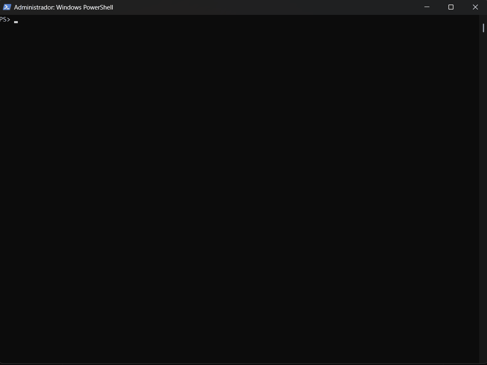

# budgetline

**See where your Claude Code budget goes — and stop hitting your limits.**

`budgetline` reads your local Claude Code history (nothing leaves your machine) and shows
what has been expensive and why, keeps your usage-limit % in sight, warns you before a
costly prompt or a session that has grown too long, and estimates new tasks with an honest
range that measures its own accuracy.



## What it does

1. **`budgetline history`: where the budget goes.** Tokens (input, cache writes, cache
   reads, output) and cost per session, plus **What's expensive**: your top tasks and the
   patterns behind the spend (long loops, sessions carrying a big context, subagents,
   cache rewrites), each with its share of your spend and a tip.
2. **Usage-limit % in your status line (optional).** `5h: 23% · 7d: 41% · $1.25 API value this session · Equiv 484k`.
   It wraps an existing status line instead of replacing it.
3. **A note on the first prompt of a session (opt-in).** If the task you start a session
   with looks expensive, a hook adds one line with its typical estimate. Follow-up messages
   never get a note. It never blocks. Details in [Prompt note](#prompt-note).
4. **Guard (opt-in): a session token budget and a context-full warning.** Delivered to
   Claude itself, so they also work during long autonomous runs. Over budget, Claude is told
   to finish the current step and propose a fresh session. It never blocks.
5. **`budgetline estimate "<task>"`: an estimate, not a promise.** Cost first, as a
   low / typical / high range from similar past tasks, the 3 closest past tasks so you can
   judge the match, and savings tips. Every estimate is checked against the task you
   actually run next, and **Accuracy so far** reports how often the range was right.

## Install

Requires **Node.js 20 or later on your `PATH`** (the plugin's hooks and commands run `node`).

### As a Claude Code plugin

Inside Claude Code:

```text
/plugin marketplace add nibforge/budgetline
/plugin install budgetline@budgetline
```

Then, in a terminal, add the usage-limit status line (a plugin cannot set it; this prints
the `settings.json` entry and installs it after asking you):

```sh
npx budgetline setup-statusline --write
```

Plugin commands:

- `/budgetline:estimate <task description>` (or `/estimate` when no other plugin uses the
  name): estimates only; it does not start the task.
- `/budgetline:budget <tokens> [--warn <tokens>|80%]` sets a budget for the session you are
  in (`60k`, `1.5M` work too); `/budgetline:budget clear` removes it.

The plugin does not put a `budgetline` command on your `PATH`. In a terminal use
`npx budgetline …` (or `npm install -g budgetline`). The examples below write
`budgetline …` for short.

### With npx (no plugin)

```sh
npx budgetline history
npx budgetline estimate "add input validation to src/api/users.ts"
```

### Commands

```text
budgetline history  [--project <text>] [--since <YYYY-MM-DD>] [--limit N] [--json] [--show-prompts] [--show-titles]
budgetline session  [--id <session id prefix>] [--json]
budgetline estimate "<task description>" [--cwd <dir>] [--session <id>] [--json]
budgetline statusline install | uninstall | status
budgetline setup-statusline [--write [--yes]]
budgetline hook enable | disable | status
budgetline guard enable [--budget N] [--warn N|80%] [--context P] [--window N|auto] | disable | status
budgetline guard session --budget N [--warn N|80%] [--session <id>] | --clear
```

## Reading the numbers

### Equiv: one number for what you spend

Claude Code bills four kinds of tokens at different prices. **Equiv** (equivalent tokens)
weights each by its price relative to a plain input token, so one number tracks what you
actually spend:

| Token | Weight |
|---|---|
| Input | 1 |
| Cache write | 1.25 (5 min) or 2 (1 h) |
| Cache read | 0.1 |
| Output | 5 |

### Why Cache R dominates

The counter beside the spinner counts the output of the current turn. But **every request
re-sends the whole conversation**: your prompt, the history, the tool results, the system
prompt, CLAUDE.md and tool definitions. Prompt caching makes those re-reads cheap (0.1 each),
but they happen on every turn and every tool round. In a long session the **Cache R** column
is millions of tokens, and it is usually most of the Equiv. That is why a task that "looked
like 200k tokens" scrolling by often costs about ten times more, and why long sessions and
big contexts are the first things `history` points at.

### The $ figure on a Pro/Max plan

The $ is the session cost Claude Code itself reports. On a plan you do not pay per token, so
it is **API-equivalent value**: what the same work would cost on the API. What limits you
is the **usage-limit %**, so once the status line has seen it, every view shows the % first.
Without limit data (pay-as-you-go API), the $ is your real cost and comes first.

## Prompt note

Off by default. `budgetline hook enable` turns it on; **`budgetline hook disable` turns it
off** (`budgetline hook status` shows which). With the plugin, run them as
`npx budgetline hook …`.

- **Only the first prompt of a session** is estimated: the first one this hook sees for that
  session id, while the transcript has no reply yet. Enabling the hook mid-session or
  resuming a session does not count as a start, and follow-up messages never get a note.
- It appears only when the typical estimate is above `hookThreshold` (500k equivalent
  tokens by default, in `config.json`).
- It uses your similar past tasks as they are, **without the bias correction** that
  `estimate` applies: that correction was measured on whole sessions, not on one message.
- With few or very different similar tasks it says so (`low confidence`) and gives the
  rough figure only, without calling the task big. `/budgetline:estimate <task>` shows the
  full range and savings tips.

## Guard


Opt-in, off by default. Two independent warnings, delivered **to Claude itself** and shown
to you:

- **Session budget**, in Equiv. At the warning threshold Claude gets one line
  (`budgetline: session at 165k/200k tokens`). Over the budget, Claude is told not to start
  new work, to finish the current step, summarize the state and propose a fresh session with
  a continuation prompt.
- **Context full**: the latest request against the model's window (70% by default). Claude
  is told that answer quality may degrade and to tell you so.

```sh
budgetline guard enable                # budget from your history (p75 of last 30 sessions; 2M fallback), warning at 80%
budgetline guard enable --budget 2000000 --warn 80% --context 70 --window auto
budgetline guard status
budgetline guard disable
budgetline guard session --budget 1200000   # this session only (from inside Claude Code)
budgetline guard session --clear
```

With the plugin, `/budgetline:budget 1.2M` sets the budget of the session you typed it in.
A target written in your prompt is only text: the guard knows nothing about it until you
set it this way. Each warning fires once per threshold; the over-budget instruction repeats.
The guard runs on the plugin's `UserPromptSubmit` and `PostToolBatch` hooks, reads only what
was appended to the transcripts since the last call, and stays silent if anything goes
wrong. After `/clear` Claude Code starts a new session, so the counters start from zero.

## Usage-limit % (status line)

Claude Code only shows your usage-limit percentages to the status line; they are not stored
anywhere. `budgetline setup-statusline --write` installs a small wrapper that records one
sample and then runs your original status line with the same input, so what you see does not
change. With no status line of your own, it shows `5h: 23% · 7d: 41% · $1.25 API value this session · Equiv 484k`
(with the guard on, `Equiv 484k/2M · ctx 37%`).

```sh
budgetline setup-statusline       # shows the entry; --write installs it (asks first)
budgetline statusline status      # samples collected and calibration
budgetline statusline uninstall   # puts your settings back exactly as they were
```

The entry runs a launcher in the data folder that finds the current plugin install each
time, so nothing needs redoing after an update. After about 10 samples and $1 of usage,
`estimate` shows a 5-hour limit %. Several sessions at once make this less accurate, and the
output says so.

## How the estimate works

1. A past **task** is one prompt plus all the responses until your next prompt (subagents
   included).
2. Tokens are combined into Equiv. Costs come from the real per-session cost Claude Code
   records; there is no bundled price table.
3. Tasks are classified as questions or changes, and only the same kind is compared.
   Similar tasks are found by keyword overlap (TF-IDF), same project ranked higher. The range
   is the 25th / 50th / 90th percentile of their spend. With fewer than 5 similar tasks, your
   overall distribution is used and flagged as low confidence.
4. Once 3 estimates have been checked against the task you ran next, new estimates are
   corrected by the measured bias, and say so.
5. **Base cost vs task cost.** Every call carries a fixed context (system prompt, tools,
   CLAUDE.md, plugins, skills, memory), measured from the first response of your recent
   sessions. The estimate shows it apart and suggests trimming it past 40k tokens.

## Privacy

- **Nothing leaves your machine.** No server, no telemetry, no network calls.
- It reads `~/.claude/projects` (or `$CLAUDE_CONFIG_DIR/projects`) read-only.
- **Your prompt text is never shown or stored** unless you pass `--show-prompts`. Sessions
  are identified by a short id and the title Claude Code gave them.
- Local data lives in `~/.budgetline` (or `$BUDGETLINE_DATA`), readable by you only (0700)
  on macOS and Linux: a per-task metrics index (keyword stems, no prompt text), status line
  samples (dropped after 30 days), past estimates (no task text), settings in `config.json`,
  the guard's per-session state and a backup of your `settings.json` if you installed the
  status line. Delete the folder to remove everything.
- Upgrading from the old name (pre-budget): the first run moves `~/.pre-budget` to
  `~/.budgetline` when the new one does not exist yet.

## Verify it yourself

Every view shows the same figures for a session. The $ is Claude Code's own
`cost.total_cost_usd` (from the status line, or the `cost-state` line in the transcript);
`budgetline` never prices a session itself when that figure exists, and when it has to
estimate, the figure starts with `~`. `budgetline session` prints the current session in the
status line's exact format, so you can compare them side by side.

**On a plan with extra usage:** note your balance, work in one session on extra usage, run
`budgetline session` and check that your balance went down by that $.

**On the API:** use a fresh key or a quiet day, work in one session, run `budgetline session`
and compare with the usage page of the Anthropic Console for that day.

If your bill differs, the difference comes from Claude Code's figure, not from `budgetline`.

## Limitations

- Estimates come from your own history. A new kind of task has no good comparison, and the
  output says so.
- Keyword similarity is good at "same area of the code" and "same kind of work", not at
  judging how hard a task is.
- Transcript formats are internal to Claude Code and can change; unknown lines are skipped.
- **History only goes back as far as Claude Code keeps transcripts: 30 days by default.**
  To keep more, set `cleanupPeriodDays` in `~/.claude/settings.json`, e.g.
  `{"cleanupPeriodDays": 90}`. See the [settings reference](https://code.claude.com/docs/en/settings-reference#cleanupperioddays).
- The usage-limit % needs the status line wrapper, and several sessions at once blur it.
- On Windows, your original status line command runs through `cmd.exe`; one written for
  Git Bash may behave differently.

## Contributing

Bug reports and pull requests are welcome; see [CONTRIBUTING](.github/CONTRIBUTING.md).
`npm install`, then `npm run verify` (lint, types, tests and build). Change only `src/`
and `tests/`: the maintainer rebuilds and commits `dist/cli.js`.

## License

MIT, see [LICENSE](LICENSE).
